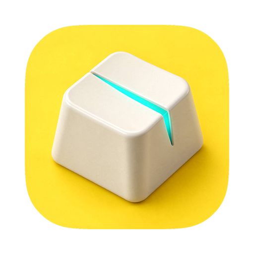

# Chatterkill · 抖抑

<p align="center">
  
</p>


**中文介绍**

Chatterkill（中文名「抖抑」）是一个 macOS 菜单栏小工具，专门治键盘的两类坏毛病：一类键太灵，轻点一下就冒出两三个字符——`apple` 打成 `apppple`，也就是俗称的**键盘连击 / 按键双击 / 抖动**；另一类键太肉，不使劲按就不出字。它一边在系统层把这些多余的重复按键吞掉，一边给出一张 108 键的检测面板，让你一眼看出到底是哪几个键在犯病，并且可以只给那几个键单独设一个更宽的延迟，不牵连其他键。

**English**

Chatterkill is a tiny macOS menu-bar utility that stops **keyboard double typing** (key chatter): keys that are too sensitive, where a light tap fires two or three characters (`apple` → `apppple`), and keys that are too mushy, where nothing shows up unless you press hard. It swallows those extra presses at the system event level — a **keyboard chatter / debounce blocker for macOS** — and gives you a 108-key tester so you can see at a glance which keys are misbehaving, then set a wider delay for just those keys, without slowing down the rest.

## 为什么做这个 / Why

我这把机械键盘用了几年，有几个键开始不听话：有的必须用力按到底才出字，有的轻轻一碰就变成连击。我试过在 GitHub 上找到的 [Eviduunce/Debounce](https://github.com/Eviduunce/Debounce) 来加延迟，确实有效，但它没法直观看出来“哪个键连击得最快”，我只能盲猜着一个个试。

所以我在它的启发下重写了这个软件：保留那套好用的拦截引擎思路，补上一块可以自己点亮键帽的检测面板，把“发现问题”和“解决问题”放进同一个窗口——点一下出问题的键，直接给它改延迟。

My mechanical keyboard is a few years old and some keys started misbehaving: a few only register when pressed hard, others double-tap from the lightest touch. I tried [Eviduunce/Debounce](https://github.com/Eviduunce/Debounce) to add a debounce delay, and it worked — but it couldn't show me *which* key was chattering fastest, so I was guessing one key at a time. Chatterkill is my take on it: same idea for the blocking engine, plus a tester panel that lights up the key caps themselves, so finding the problem and fixing it happen in one window.

## 五种颜色是什么意思 / The five states

**中文**

1. **未测（深灰）** —— 这次检测里还没按过，没有数据。
2. **正常（绿）** —— 间隔和按住时长都在阈值内，这个键是好的。
3. **太快 · 连击（红）** —— 两次按下的间隔短于阈值，多出来的那次已经被吞掉。
4. **迟钝 · 过久（蓝）** —— 按住时间明显超过正常点按，就是那种要用力才出字的键。
5. **固件层不上报（暗）** —— 这类键 macOS 根本收不到（比如 Fn），测不了也拦不了。

**English**

1. **Untested (grey)** — not pressed yet in this session, no data.
2. **Normal (green)** — interval and hold time both inside the threshold; the key is fine.
3. **Too fast / chatter (red)** — the second press landed inside the threshold and was already swallowed.
4. **Slow / held too long (blue)** — held far longer than a normal tap; the kind of key that only fires when you press hard.
5. **Never reported (dark)** — the key never reaches macOS (e.g. Fn), so it can't be measured or blocked.

## 几个刻意的设计 / Deliberate choices

- **功能键永远不拦。** `Command` / `Shift` / `Option` / `Control` / `Fn` 走的是 `flagsChanged`，引擎压根不监听这条通道，所以任何快捷键都不会被吞掉、不会被改。这是故意的，不是漏掉了。

- **检测面板就是设置。** 关掉面板时 WebView 连同它的辅助进程一起销毁，只剩拦截引擎常驻，不占 CPU、不占内存。检测完就关掉，是设计，不是妥协。

- **按系统语言自动切换。** 系统是中文就是中文，其他语言就是英文，没有语言选择器——全部文案也就十来个词。

- **开机即监听。** 开机自启默认开启，重启后不用点任何东西，拦截就在跑。

- **Function keys are never intercepted.** `Command` / `Shift` / `Option` / `Control` / `Fn` travel on `flagsChanged`, which the engine doesn't subscribe to at all — so no shortcut is ever swallowed or rewritten. Intentional.

- **The tester** ***is*** **the settings window.** Closing it tears down the WebView and its helper process; only the event engine stays resident. One-shot calibration, zero idle cost.

- **Language follows the system.** Chinese system → Chinese UI, anything else → English. No language picker.

- **Blocking starts at login.** Launch-at-login is on by default.

## 系统要求 / Requirements

- **仅 Apple Silicon**（arm64，M1 及之后）。不提供 Intel 版本。| **Apple Silicon only** (arm64). No Intel build.

- macOS 14 Sonoma 或更新版本（在 macOS 27 上测过）。| macOS 14 or newer (tested up to macOS 27).

- **只需要一个权限：辅助功能（Accessibility）。** 不需要输入监控、不需要完全磁盘访问。| Only **Accessibility**. No Input Monitoring, no Full Disk Access.

- 常驻内存约 20–30 MB，空闲 CPU 基本是 0.0%。| \~20–30 MB resident, idle CPU ≈ 0.0%.

- 关掉键盘连击检测面板后，面板进程退出、内存回落，主程序的监听引擎继续常驻。| Closing the chatter tester tears down the panel process and drops the memory; the blocking engine keeps running.

## 安装 / Install

1. 从 Releases 下载 `Chatterkill.dmg`，把 **Chatterkill** 拖进 `/Applications`。| Download `Chatterkill.dmg` from Releases and drag **Chatterkill** into `/Applications`.

2. 首次打开请**右键 → 打开**（没有公证签名，双击会被 Gatekeeper 挡住）。| First launch: **right-click → Open** (the build isn't notarized, so double-click is blocked by Gatekeeper).

   看到「Apple 无法检查其是否包含恶意软件」别慌——对于没有付费证书的免费应用来说，这些提示都是正常的。Chatterkill 的全部代码都[在 GitHub 上开源](https://github.com/Samuelonly/chatterkill)，运行前你可以先读代码。| Seeing "Apple cannot check it for malicious software"? Those prompts are normal for free apps without a paid certificate. Everything Chatterkill does is [open on GitHub](https://github.com/Samuelonly/chatterkill), so you can read the code before running it.

3. 或者在终端里去掉隔离标记：| Or clear the quarantine flag:

   ```bash
   xattr -d com.apple.quarantine /Applications/Chatterkill.app
   ```

4. 系统会要求**辅助功能**权限：系统设置 → 隐私与安全性 → 辅助功能 → 勾上 Chatterkill。| Grant **Accessibility** when asked: System Settings → Privacy & Security → Accessibility → enable Chatterkill.

5. 菜单栏图标 → 确认「开机自启」已勾上。| Menu-bar icon → make sure **Launch at Login** is checked.

打开后没有 Dock 图标，它只活在菜单栏里。双击 App 图标会直接弹出检测面板。

There's no Dock icon; it lives in the menu bar only. Double-clicking the app icon reopens the tester panel.

## 使用 / Use

1. 菜单栏图标 → **打开检测面板…** | menu-bar icon → **Open Tester…**
2. 打一段字，或者把怀疑的键各按几下。| Type a paragraph, or tap each suspect key a few times.
3. 红键 = 连击，蓝键 = 迟钝，绿键 = 正常。| Red = chattering, blue = mushy, green = fine.
4. 点任意键帽 → 选 50–300 ms 的阈值；**Use global** 取消这个键的单独设置。| Click any key cap → pick a 50–300 ms threshold; **Use global** removes the per-key override.
5. 点 **DONE** 或关窗：面板销毁，只留引擎。| Click **DONE** or close the window: panel destroyed, engine stays.
6. 菜单栏里还能看到**今日拦截 / 累计拦截**两栏统计（今日每天零点自动清零）。| The menu also shows **blocked today / blocked total** (today resets at midnight).

配置文件：`~/Library/Application Support/Chatterkill/config.json` | Config lives at the same path.

## 与上游的关系 / Credits

引擎和菜单栏外壳参考并改写了 [Eviduunce/Debounce](https://github.com/Eviduunce/Debounce)（MIT，作者 Timo Leisengang，版权声明保留在对应源文件里）；检测面板是全新写的。许可同为 MIT。

The event engine and menu-bar shell are forked from [Eviduunce/Debounce](https://github.com/Eviduunce/Debounce) (MIT, © Timo Leisengang; notices preserved in the forked files). The tester panel is an original build. MIT licensed.

## 从源码构建 / Build

不需要 Xcode，只要 Command Line Tools + Swift 6：| No Xcode needed — Command Line Tools plus Swift 6:

```bash
./scripts/build-app.sh      # -> dist/Chatterkill.app (arm64)
./scripts/create-dmg.sh     # -> dist/Chatterkill.dmg
```

脚本会在二进制里出现 `x86_64` 切片时直接失败——这个项目只发 arm64。| The build fails on purpose if the binary contains an `x86_64` slice.

## 目录 / Layout

```
Sources/Chatterkill/
  App/        main.swift, AppDelegate.swift, PanelController.swift
  Engine/     ChatterBlocker.swift, EventInterceptor.swift, KeyMap.swift, BlockCounter.swift
  Support/    ConfigStore.swift, PermissionHelper.swift, Loc.swift
Resources/
  web/        index.html, app.js      (tester panel, zero network calls)
  Info.plist, zh-Hans.lproj, AppIcon.icns
scripts/      build-app.sh, create-dmg.sh
```

## 已知限制 / Known limits

- 密码框、`sudo`、Touch ID 这类安全输入，macOS 会主动禁用事件监听，拦不了，这是系统行为。| macOS disables event taps around secure input (password fields, `sudo`, Touch ID). Not a bug.

- α 版本只做“吞掉多余按键”，不会帮迟钝的键补发字符。| The alpha only swallows extra presses; it won't re-send characters for mushy keys.

- 自己重新编译会改变签名，辅助功能里的旧授权会失效，需要删掉重新勾一次。| Rebuilding changes the signature, which invalidates the Accessibility grant — remove the stale entry and grant again.

## License

MIT. See [LICENSE](LICENSE).
